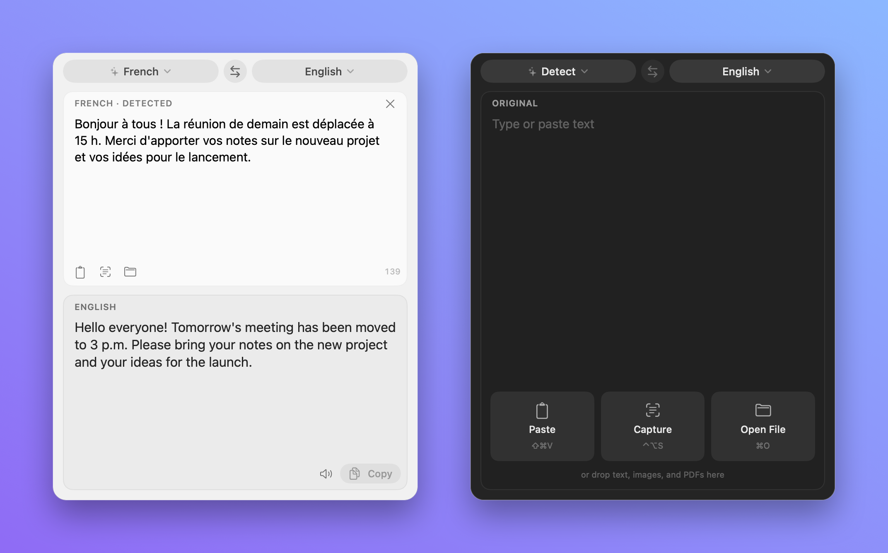

# Floatlate

A floating translator for macOS. It stays on top of every app and Space, and lives in the menu bar.



## Input

- Type or paste text.
- Paste anything with ⇧⌘V: text, an image, or a copied file.
- Drop text, images, PDFs, or documents (.txt, .rtf, .docx, .html) on the window.
- Press ⌃⌥S anywhere, then drag over part of the screen. Floatlate reads the text and translates it.

## Shortcuts

| Keys | Action |
| --- | --- |
| ⌃⌥T | Show or hide the window |
| ⌃⌥S | Capture text from the screen |
| ⇧⌘V | Paste text, image, or file |
| ⌘O | Open a file |
| ⇧⌘C | Copy the translation |
| ⌘K | Clear |
| Esc | Hide |

## How it works

- Apple's Translation framework translates on the device. No account, no API key.
- Vision reads text from images and scanned PDFs.
- Lines show as soon as each one is translated.
- If the text is already in your target language, Floatlate translates it into the last language you translated from.

## Speed and quality

Floatlate uses Apple's fast translation model by default.

- The first time you translate between two languages, macOS asks to download that pair. Approve it once.
- For better but slower results, choose **High-Quality Translation (Slower)** in the menu bar menu. It takes about 0.7 seconds per line.
- The high-quality option needs macOS 26.4 or later. Older systems use Apple's default model.

## Permissions

- The first ⌃⌥S asks for Screen Recording access. Allow it in System Settings → Privacy & Security → Screen & System Audio Recording.
- The build is self-signed, so macOS may ask again after each rebuild.

## Build

```bash
./build.sh
```

```bash
ditto build/Floatlate.app ~/Applications/Floatlate.app
```

To redraw the app icon after changing `Scripts/make-icon.swift`:

```bash
swift Scripts/make-icon.swift Resources/AppIcon.icns
```

To redraw the README screenshot after a UI change:

```bash
./Scripts/make-screenshots.sh
```

Requires macOS 15 or later.

## License

[MIT](LICENSE)
